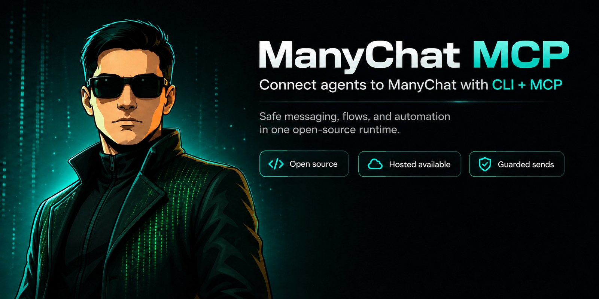
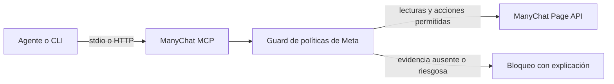

# ManyChat MCP



Servidor MCP y CLI de código abierto para consultar datos de ManyChat y solicitar acciones de mensajería sujetas a políticas.

> **La versión 0.2.0 permite consultar datos y explorar el CRM (búsquedas, etiquetas y campos). Los mensajes y las escrituras protegidas del CRM están bloqueados.** ManyChat no proporciona evidencia confiable del canal de la interacción y el guard falla de forma segura, incluso si no hay un proveedor de evidencia configurado. Esta versión no es un producto de automatización de mensajería. Los envíos y escrituras protegidas requieren una integración futura con evidencia (objetivo 0.3.0; aún no incluida).

## Cómo funciona



## Instalar

`0.2.0` es la versión del paquete; su publicación está planeada, no afirmamos que ya esté disponible. Cuando se publique, ejecuta el paquete con `npx -y mcp-manychat`. Incluye los comandos `manychat` y `manychat-mcp`. Requiere Node 22 o posterior.

```sh
npx -y mcp-manychat --version
npx -y mcp-manychat page info
```

Consulta [configuración por cliente](docs/connect.md). No hace falta clonar el código, cambiar de rama ni indicar rutas absolutas.

## Pégale esto a tu agente

Los textos usan marcadores de posición. Guarda la API key en tu entorno local o gestor de secretos. Nunca la pegues en el chat, un prompt, el código fuente ni una configuración compartida. Para HTTP, el servidor no toma una key del entorno: cada petición a `/mcp` debe incluir `X-ManyChat-API-Key`.

### Claude Code
```text
Configura ManyChat MCP en este espacio de trabajo con las instrucciones oficiales del proyecto. Usa stdio y lee MANYCHAT_API_KEY desde mi entorno local. No me pidas pegar la key en el chat ni la guardes en un archivo versionado. Comprueba la conexión con una consulta de solo lectura a page info. No envíes mensajes salvo que te lo pida de forma explícita y el guard de políticas lo permita. Registra el comando `npx` con argumentos `["-y", "mcp-manychat", "mcp", "serve", "--transport", "stdio"]` usando la configuración de Claude Code en docs/connect.md.
```
### Claude Desktop
```text
Configura ManyChat MCP para Claude Desktop con el comando stdio documentado. Obtén MANYCHAT_API_KEY del entorno del sistema o de un gestor local de secretos; no incluyas su valor en este chat ni en archivos versionados. Prueba solo con page info. No envíes mensajes sin mi autorización explícita y una validación aprobada. Registra el comando `npx` con argumentos `["-y", "mcp-manychat", "mcp", "serve", "--transport", "stdio"]` usando la configuración de Claude Desktop en docs/connect.md.
```
### Cursor
```text
Agrega el servidor ManyChat MCP stdio documentado a la configuración local de Cursor. Mantén MANYCHAT_API_KEY fuera del repositorio. No me pidas compartirla por chat. Comprueba con page info solamente. Pide mi autorización antes de enviar y respeta cualquier bloqueo del guard. Registra el comando `npx` con argumentos `["-y", "mcp-manychat", "mcp", "serve", "--transport", "stdio"]` usando la configuración de Cursor en docs/connect.md.
```
### Codex
```text
Configura ManyChat MCP con el método stdio documentado para Codex. Lee MANYCHAT_API_KEY de una fuente local de secretos; no la muestres, solicites por chat ni guardes en el repositorio. Verifica con page info, en modo de solo lectura. No envíes sin mi autorización explícita y la aprobación del guard. Registra el comando `npx` con argumentos `["-y", "mcp-manychat", "mcp", "serve", "--transport", "stdio"]` usando la configuración de Codex en docs/connect.md.
```
### OpenCode
```text
Configura la conexión stdio documentada de ManyChat MCP en OpenCode. Guarda MANYCHAT_API_KEY en el entorno local o un gestor de secretos, nunca en este prompt ni en archivos versionados. Prueba con page info. Pide autorización antes de enviar y considera definitivo cualquier rechazo del guard. Registra el comando `npx` con argumentos `["-y", "mcp-manychat", "mcp", "serve", "--transport", "stdio"]` usando la configuración de OpenCode en docs/connect.md.
```
### Hermes
```text
Configura ManyChat MCP por stdio según la documentación. Obtén MANYCHAT_API_KEY de un gestor local de secretos; nunca la incluyas en el chat ni en archivos del repositorio. Verifica con page info solamente. No envíes mensajes sin mi solicitud explícita y la aprobación del guard. Registra el comando `npx` con argumentos `["-y", "mcp-manychat", "mcp", "serve", "--transport", "stdio"]` usando la configuración de Hermes en docs/connect.md.
```
### n8n (HTTP)
```text
Crea una conexión HTTP MCP de n8n al endpoint ManyChat MCP configurado, en /mcp. Adjunta X-ManyChat-API-Key desde las credenciales de n8n en cada petición. No pongas la key en texto de nodos, exportaciones ni logs. Verifica con page info. No envíes sin mi autorización explícita y la aprobación del guard. El servidor no usa una key del entorno para HTTP. Configura MCP Client con Streamable HTTP, URL https://TU-SERVIDOR/mcp y credencial Header Auth con nombre X-ManyChat-API-Key; consulta docs/connect.md. No crees ni despliegues un servidor sin autorización.
```
### VS Code
```text
Configura el servidor ManyChat MCP stdio documentado para VS Code. Guarda MANYCHAT_API_KEY en el entorno local o en un gestor de secretos, nunca en este prompt ni en archivos versionados del espacio. Verifica solo con page info. Pide autorización antes de enviar y respeta los bloqueos del guard. Registra el comando `npx` con argumentos `["-y", "mcp-manychat", "mcp", "serve", "--transport", "stdio"]` usando la configuración de VS Code en docs/connect.md.
```

## CLI

```sh
manychat --version
manychat mcp serve --transport stdio
manychat mcp serve --transport http
manychat page info
manychat tags list
manychat subscribers get ID
manychat validate ID
manychat call TOOL_NAME JSON
manychat send text ID TEXT
manychat send content ID JSON
manychat send flow ID FLOW
```

El CLI también ofrece `validate ID` y `call TOOL_NAME JSON`. La versión 0.2.0 permite lecturas/operaciones CRM; las operaciones de etiquetas y campos que podrían iniciar mensajes están protegidas y se bloquean sin evidencia verificada. Todos los envíos del CLI pasan por el mismo guard que los envíos MCP. Si falta evidencia confiable del canal, el guard bloquea. HTTP publica MCP en `/mcp` y requiere `X-ManyChat-API-Key` en cada petición. No usa una API key del entorno.

## Canales y límites

| Canal | Lectura / conexión | Envíos |
|---|---|---|
| WhatsApp | ManyChat puede exponer identificadores y opt-in | No prometemos envíos operativos. La ventana estándar es de 24 horas, pero el esquema oficial actual no prueba el canal de la interacción. Fuera de 24 horas, la API de ManyChat no envía plantillas aprobadas con `sendContent`. |
| Instagram | Los datos pueden incluir identificadores de Instagram | No prometemos envíos sin evidencia del canal. Se bloquean etiquetas de mensaje obsoletas; HUMAN_AGENT es para atención humana, no automatización. |
| Messenger | Los datos pueden incluir identificadores de Messenger | No prometemos envíos sin evidencia del canal. HUMAN_AGENT exige una persona, App Review y verificación del negocio; no autoriza automatizaciones. |
| TikTok | No confirmamos capacidad de envío | No prometemos envíos. |
| Telegram | Fuera del alcance de políticas de Meta | No prometemos envíos. |
| SMS | Fuera del alcance de políticas de Meta | No prometemos envíos. |
| Email | Fuera del alcance de políticas de Meta | No prometemos envíos. |

Las conversaciones originadas en anuncios pueden calificar para una ventana de siete días según las reglas de Meta. El servidor exige evidencia confiable y verificada del origen; no acepta declaraciones del agente. Consulta [política y fuentes](docs/policy.md).

## Herramientas

El servidor anuncia estas 28 herramientas (incluye `validate_message`):

`get_subscriber`, `find_subscriber_by_email`, `find_subscriber_by_phone`, `find_subscriber_by_name`, `create_subscriber`, `update_subscriber`, `list_tags`, `create_tag`, `add_tag_to_subscriber`, `add_tag_to_subscriber_by_name`, `remove_tag_from_subscriber`, `remove_tag_from_subscriber_by_name`, `list_custom_fields`, `create_custom_field`, `set_custom_field`, `set_custom_field_by_name`, `set_custom_fields_bulk`, `list_flows`, `send_flow`, `send_text_message`, `send_content`, `validate_message`, `get_page_info`, `list_bot_fields`, `set_bot_field`, `list_growth_tools`, `list_otn_topics`, `health_check`.

## Seguridad

- El guard usa datos del suscriptor obtenidos del servidor y evidencia confiable de proveedores. No acepta un canal o ventana declarados por el agente.
- `getInfo` de ManyChat expone `last_interaction`, pero no identifica el canal de esa interacción. Sin evidencia confiable adicional, los envíos se bloquean.
- La API de ManyChat no envía plantillas de WhatsApp mediante `sendContent`. Un flow no omite el guard.
- Los modos OAuth heredados pueden usar memoria local o Redis. La memoria se pierde al reiniciar y no se comparte entre instancias; para varias instancias se necesita almacenamiento compartido.
- En HTTP, el cliente administra las credenciales en headers. Nunca registres las keys ni las pegues en prompts.
- Conectar una cuenta no demuestra que todos sus canales estén soportados.

Consulta [arquitectura](docs/architecture.md), [política y fuentes](docs/policy.md) y [releases](docs/releasing.md). El proyecto conserva la licencia y atribución de origen: [LICENSE](LICENSE).

## Operación y pruebas

`pnpm lint`, `pnpm typecheck`, `pnpm test`, `pnpm build` y `pnpm test:mutation` no requieren una cuenta de ManyChat. Los tests permiten sockets locales, pero bloquean fetch hacia servicios externos. El smoke real es opcional: `MANYCHAT_API_KEY` y `MANYCHAT_SMOKE_SUBSCRIBER_NAME` deben existir en el entorno antes de `pnpm smoke:readonly`. Solo hace tres GET y no imprime datos de contactos.

**Estado de despliegue:** Docker, Render y OAuth con Redis no se han verificado en un despliegue real. HTTP aplica límites de 120 peticiones por IP/minuto y 60 por hash de key/minuto, body de 32 KB, timeout de upstream de 20 s y timeouts de socket. Producción exige `REDIS_URL` para compartir contadores; OAuth exige además `OAUTH_STORE=redis` y `MCP_BASE_URL` HTTPS. No hay sesiones MCP ni afinidad de instancia. La memoria sirve solo para desarrollo. Configura `TRUST_PROXY_CIDRS` solo con proxies confiables y `MCP_ALLOWED_ORIGINS` con orígenes exactos. Usa TLS en la entrada y Redis con TLS/ACL.

`send_content` acepta texto, imagen, video y audio; esta versión no acepta cards, botones ni acciones de Dynamic Content. Un flow es opaco: el guard comprueba su inicio, no inspecciona mensajes futuros dentro de ManyChat. El remitente debe revisar el flow. No hay reintentos automáticos de POST ni garantía de entrega idempotente. El flag `promotional` no es un clasificador de texto; quien envía debe declarar la intención correctamente.


## Configuración del servidor

`MCP_REMOTE_AUTH` elige `manychat_header` (predeterminado) u `oauth`; son modos excluyentes. `PORT` usa `3000` por defecto y `HOST`, `0.0.0.0`. `LOG_LEVEL` acepta `debug`, `info`, `warn` o `error` (predeterminado: `info`). Producción exige `TRUST_PROXY_CIDRS` para los proxies de entrada conocidos o `TRUST_PROXY_HOPS` (entero de 1 a 16), nunca ambos. Render usa `TRUST_PROXY_HOPS=1`; confiar por saltos solo es seguro si todas las peticiones llegan por ese proxy y se bloquean las rutas directas o más cortas. `/health` queda fuera del límite de peticiones. `MANYCHAT_ALLOW_HUMAN_AGENT=1` es una opción exclusiva del servidor, apagada por defecto, para soporte operado por humanos; las herramientas no pueden declararse humanas. No demuestra autoría humana ni aprobación de Meta. Todo almacén OAuth en Redis exige `OAUTH_ENC_KEY`: exactamente 64 caracteres hexadecimales (32 bytes aleatorios), compartida de forma segura entre instancias. Los registros OAuth usan AES-256-GCM y las claves de credenciales usan identificadores SHA-256. Consulta [arquitectura](docs/architecture.md) para las cuotas de registro y los límites de rotación de la clave.
