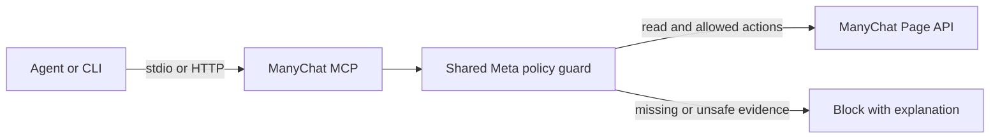

# ManyChat MCP


An open-source MCP server and CLI for reading ManyChat data and requesting policy-checked messaging actions.

> **Version 0.2.0: read access and CRM inspection (searches, tags, and fields). Messaging and guarded CRM writes are blocked.** ManyChat provides no trusted interaction-channel evidence, so the guard fails closed—including when no evidence provider is configured. Do not treat this release as a messaging automation product. Sending and guarded writes require a future, evidenced integration (target 0.3.0; not shipped).

## How it works



## Install

Version `0.2.0` is the package version; publication is planned, not currently claimed. Once published, run the package directly with `npx -y mcp-manychat`. It exposes the `manychat` and `manychat-mcp` commands. Node 22 or newer is required.

```sh
npx -y mcp-manychat --version
npx -y mcp-manychat page info
```

See [client configurations](docs/connect.md). No source clone, branch checkout, or absolute build path is needed.

## Paste this to your agent

These client prompts use placeholders. Put the API key in your local environment or secret manager. Never paste it into an agent chat, prompt, source file, or shared config. The server does not fall back to an environment key for HTTP requests; send `X-ManyChat-API-Key` on each `/mcp` request.

### Claude Code
```text
Set up the ManyChat MCP server for this workspace using the official project instructions. Use stdio and read MANYCHAT_API_KEY from my local environment. Do not ask me to paste the key into chat or write it to a tracked file. Verify setup with a read-only page info call. Do not send messages unless I explicitly request one and the policy guard approves it. Register command `npx` with arguments `["-y", "mcp-manychat", "mcp", "serve", "--transport", "stdio"]` using the Claude Code configuration in docs/connect.md.
```
### Claude Desktop
```text
Configure ManyChat MCP for Claude Desktop with the documented stdio command. Reference MANYCHAT_API_KEY through the operating system's local environment or secret manager; never include its value in this chat or a config committed to source control. Test only with page info. Do not send messages without my explicit request and a successful policy check. Register command `npx` with arguments `["-y", "mcp-manychat", "mcp", "serve", "--transport", "stdio"]` using the Claude Desktop configuration in docs/connect.md.
```
### Cursor
```text
Add the documented ManyChat MCP stdio server to my local Cursor MCP configuration. Keep MANYCHAT_API_KEY outside the repository and do not ask me to share it in chat. Verify with page info only. Require my explicit approval before any send, and respect every policy-guard block. Register command `npx` with arguments `["-y", "mcp-manychat", "mcp", "serve", "--transport", "stdio"]` using the Cursor configuration in docs/connect.md.
```
### Codex
```text
Configure the ManyChat MCP server using the documented stdio setup for Codex. Read MANYCHAT_API_KEY from a local secret source; do not print, request in chat, or commit the value. Verify with a read-only page info call. Do not send unless I explicitly request it and the guard permits it. Register command `npx` with arguments `["-y", "mcp-manychat", "mcp", "serve", "--transport", "stdio"]` using the Codex configuration in docs/connect.md.
```
### OpenCode
```text
Set up the documented ManyChat MCP stdio connection in OpenCode. Keep MANYCHAT_API_KEY in a local environment or secret store, never in this prompt or tracked files. Test with page info. Ask before sending and treat a guard rejection as final. Register command `npx` with arguments `["-y", "mcp-manychat", "mcp", "serve", "--transport", "stdio"]` using the OpenCode configuration in docs/connect.md.
```
### Hermes
```text
Configure ManyChat MCP using the documented stdio transport. Source MANYCHAT_API_KEY from a local secret store and never include its value in chat or repository files. Verify with page info only. Do not send messages unless I explicitly request it and the policy guard approves. Register command `npx` with arguments `["-y", "mcp-manychat", "mcp", "serve", "--transport", "stdio"]` using the Hermes configuration in docs/connect.md.
```
### n8n (HTTP)
```text
Create an n8n HTTP MCP connection to the configured ManyChat MCP endpoint at /mcp. Attach X-ManyChat-API-Key from n8n credentials to every request; do not put the key in node text, expressions visible in exports, or logs. Verify with page info. Do not send unless I explicitly request it and the server guard permits it. The server does not use an environment-key fallback for HTTP. Configure MCP Client with Streamable HTTP, URL https://YOUR-SERVER/mcp and a Header Auth credential named X-ManyChat-API-Key; see docs/connect.md. Do not provision or deploy a server without approval.
```
### VS Code
```text
Configure the documented ManyChat MCP stdio server for VS Code. Keep MANYCHAT_API_KEY in a local environment or secret manager, never in this prompt or tracked workspace files. Verify with page info only. Ask me before any send and honor policy-guard blocks. Register command `npx` with arguments `["-y", "mcp-manychat", "mcp", "serve", "--transport", "stdio"]` using the VS Code configuration in docs/connect.md.
```

## CLI

```sh
manychat --version
manychat mcp serve --transport stdio
manychat mcp serve --transport http
manychat page info
manychat tags list
manychat subscribers get ID
manychat validate ID
manychat call TOOL_NAME JSON
manychat send text ID TEXT
manychat send content ID JSON
manychat send flow ID FLOW
```

The CLI supports `validate ID` and `call TOOL_NAME JSON`. Version 0.2.0 read/CRM operations are available; tag/field operations that could trigger messaging are guarded and blocked without verified evidence. Every CLI send uses the same policy guard as MCP sends. A blocked send is expected when channel evidence is unavailable. HTTP serves MCP at `/mcp`; every request needs `X-ManyChat-API-Key`. HTTP does not inherit an environment API key.

## Channel support, honestly

| Channel | Read / account connection | Send claim |
|---|---|---|
| WhatsApp | ManyChat data may expose WhatsApp identifiers and opt-in | No live-send promise. The standard window is 24 hours, but the current official schema does not prove the interaction channel. Outside 24 hours, ManyChat's API cannot send approved WhatsApp templates through `sendContent`. |
| Instagram | Subscriber data may include Instagram identifiers | No live-send promise without channel evidence. Deprecated message tags are blocked; HUMAN_AGENT is for human support, not automation. |
| Messenger | Subscriber data may include Messenger identifiers | No live-send promise without channel evidence. HUMAN_AGENT requires a person, App Review, and business verification; it does not authorize automation. |
| TikTok | No confirmed sending capability | No confirmed send support. |
| Telegram | Outside this Meta-policy wedge | No send support promised. |
| SMS | Outside this Meta-policy wedge | No send support promised. |
| Email | Outside this Meta-policy wedge | No send support promised. |

Ad-origin conversations may qualify for a seven-day window under Meta rules. This server requires trusted, verified origin evidence before using that exception and does not accept agent-supplied claims. See [policy](docs/policy.md).

## Tools

The server advertises these 28 tools (including `validate_message`):

`get_subscriber`, `find_subscriber_by_email`, `find_subscriber_by_phone`, `find_subscriber_by_name`, `create_subscriber`, `update_subscriber`, `list_tags`, `create_tag`, `add_tag_to_subscriber`, `add_tag_to_subscriber_by_name`, `remove_tag_from_subscriber`, `remove_tag_from_subscriber_by_name`, `list_custom_fields`, `create_custom_field`, `set_custom_field`, `set_custom_field_by_name`, `set_custom_fields_bulk`, `list_flows`, `send_flow`, `send_text_message`, `send_content`, `validate_message`, `get_page_info`, `list_bot_fields`, `set_bot_field`, `list_growth_tools`, `list_otn_topics`, `health_check`.

## Security and limits

- The guard uses server-derived subscriber data and trusted provider evidence. It never trusts a caller's declared channel or interaction window.
- Current ManyChat `getInfo` exposes `last_interaction` but does not establish the channel for that interaction. Sends fail closed without separate trusted evidence.
- ManyChat's API cannot send WhatsApp templates through `sendContent`; flows may have separate capabilities but cannot bypass this guard.
- OAuth modes retained from the prior project can use in-memory state or Redis. In-memory state does not survive restarts or span instances; use shared storage for multi-instance OAuth.
- HTTP credentials belong in request headers managed by your client. Never log keys or paste them into prompts.
- Connecting an account does not establish support for every channel.

See [architecture](docs/architecture.md), [policy and sources](docs/policy.md), and [releasing](docs/releasing.md). The project retains its upstream license and attribution; see [LICENSE](LICENSE).

## Operations and tests

`pnpm lint`, `pnpm typecheck`, `pnpm test`, `pnpm build` and `pnpm test:mutation` need no ManyChat account. Tests permit local sockets but block external fetches. The live smoke is separate and optional: set `MANYCHAT_API_KEY` and `MANYCHAT_SMOKE_SUBSCRIBER_NAME` locally before `pnpm smoke:readonly`. It performs three GETs and prints no subscriber data.

**Deployment status:** Docker, Render, and OAuth with Redis have not been verified in a real deployment. HTTP limits requests to 120/IP/minute and 60/credential-hash/minute, caps bodies at 32 KB, uses a 20 s upstream deadline and socket timeouts. Production requires `REDIS_URL` for shared counters. OAuth additionally requires `OAUTH_STORE=redis` and an HTTPS `MCP_BASE_URL`. MCP has no sessions or instance affinity. Memory storage is development-only. Configure `TRUST_PROXY_CIDRS` only for trusted proxies and `MCP_ALLOWED_ORIGINS` with exact origins. Terminate TLS at ingress and secure Redis with TLS/ACLs.

`send_content` accepts text, image, video and audio; this version does not accept Dynamic Content cards, buttons or actions. A flow is opaque: the guard checks its dispatch, not later messages inside ManyChat. The sender must review the flow. POST requests are not retried and delivery is not idempotent. The `promotional` flag is not a text classifier; the sender must classify intent honestly.


## Server configuration / Configuración del servidor

`MCP_REMOTE_AUTH` selects `manychat_header` (default) or `oauth`; the modes are exclusive. `PORT` defaults to `3000`; `HOST` to `0.0.0.0`. `LOG_LEVEL` accepts `debug`, `info`, `warn`, or `error` (default `info`). Production requires either `TRUST_PROXY_CIDRS` for known ingress proxies or `TRUST_PROXY_HOPS` (integer 1–16), never both. Render uses `TRUST_PROXY_HOPS=1`; hop-count trust is safe only when every request arrives through that proxy and direct/shorter paths are blocked. `/health` bypasses rate limits. `MANYCHAT_ALLOW_HUMAN_AGENT=1` is a server-only opt-in, off by default, for human-operated support; tools cannot self-declare human status. It does not prove human authorship or Meta approval. Every Redis OAuth store requires `OAUTH_ENC_KEY`: exactly 64 hexadecimal characters (32 random bytes), shared securely across instances. OAuth records use AES-256-GCM; credential keys use SHA-256 identifiers. See [architecture](docs/architecture.md) for registration limits and key rotation constraints.
