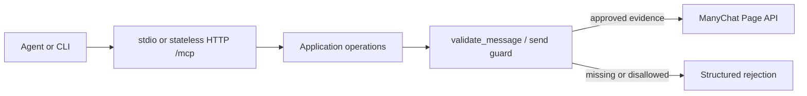

# Architecture

## Runtime path

The `manychat` CLI and MCP server expose the same application operations. MCP supports stdio and stateless HTTP at `/mcp`. HTTP authentication is per request through `X-ManyChat-API-Key`; the server must not substitute a process environment key. Every send path, including CLI commands and MCP tools, calls the shared policy guard before invoking a ManyChat send operation.

## Current evidence constraint

ManyChat `GET /fb/subscriber/getInfo` returns `last_interaction` as a W3C timestamp and may return null. Its current official `Subscriber` schema also includes channel identifiers such as `ig_id`, `whatsapp_phone`, `whatsapp_bsuid`, and `whatsapp_username`, but does not identify the channel associated with `last_interaction`. A connected identifier does not prove the latest interaction channel. The guard must fail closed for sends unless trusted provider evidence supplies the channel. Agent input is never trusted evidence.

The guard can use the standard 24-hour window only when evidence establishes the channel and interaction timestamp. A verified ad-origin extension may allow up to seven days only when a trusted source proves that origin. Without such evidence, apply the conservative 24-hour rule. Current schema limitations mean send eligibility is not established by this repository alone.

## Adding a tool

1. Define and validate input at the boundary.
2. Implement the operation in the application layer rather than embedding policy in a transport handler.
3. Route all side effects through shared services. Every send path must call the guard.
4. Register the tool for MCP and, where applicable, expose an explicit CLI command that uses the same application operation.
5. Add tests for valid input, invalid input, API errors, and policy denial/allowance. Test callers as well as guard functions.
6. Update both READMEs only after confirming the actual advertised tool surface.

## Adding a policy rule

Keep rule logic in the shared guard. Document the rule and dated authoritative source in `docs/policy.md`; do not infer permission from an agent's requested tag, declared channel, or claimed ad origin. Test both the blocking and permitted sides. If required evidence is absent or malformed, return a clear rejection without calling the send API.

## Adding authentication

Keep transport authentication separate from ManyChat's upstream credential handling. HTTP validates `X-ManyChat-API-Key` on each request and never falls back to a process environment key. Do not log credentials or sensitive headers. Preserve OAuth state behavior carefully: in-memory state is process-local and ephemeral; Redis can support shared state only when configured and validated.

## Source map

- `src/index.ts`: executable, package-derived version, transport selection.
- `src/cli/app.ts`: CLI parsing; `call TOOL_NAME JSON` also uses the shared engine. No raw POST escape hatch.
- `src/server.ts`: deterministic registration of the 28 tools, constructed per request.
- `src/core/engine.ts`: operation schemas, upstream routing, `ExecutionEngine` and trusted `EvidenceProvider` boundary. Add tools to `operations` here.
- `src/core/manychat-client.ts`: fixed ManyChat origin, deadlines, generic errors and no automatic POST retries.
- `src/policy/guard.ts`: channel/window/tag evaluation from trusted evidence. Add policy rules here and caller-level regressions in `tests/engine.test.ts` / `tests/http.test.ts`.
- `src/mcp/http.ts`: Streamable HTTP, exclusive auth-mode selection, origin checks, 32 KB bodies and socket deadlines.
- `src/mcp/rate-limit.ts`: bounded development counters or atomic shared Redis counters.
- `src/auth/`: OAuth routes, PKCE, atomic code consumption and rotating refresh tokens. Authentication changes belong here and in the HTTP credential resolver, never in tool arguments.

## Evidence adapter contract

`EvidenceProvider.resolve(subscriberId)` may return `{ subscriberId, channel, lastUserInteractionAt, source: "verified-webhook", adReferral? }`. Only application code can install this adapter; neither the shipped CLI nor HTTP/MCP exposes a registration flag. No production adapter ships in 0.2.0. A future adapter must authenticate the event source, bind its account and subscriber to the executing ManyChat credential, reject replays and protect its storage. The string `verified-webhook` is a contract with trusted application code, not a signature verifier.

The engine fetches `getInfo` for each validation/send and requires its `id` and `last_interaction` to match that proof. The provider must bind events to the credential's account; a subscriber ID alone is not a cross-account authorization boundary. For an ad extension, `adReferral` must identify the matching Click-to-Messenger or Click-to-Direct origin, include `verified: true` and the first user-message timestamp. Seven days start at that first message, not the latest interaction. Without that proof, only the standard 24-hour rule applies. Future/invalid timestamps block.

`human_agent: true` is an explicit human-support declaration, not proof that a person wrote the text or that Meta granted App Review. The sender remains responsible for both. Tagged content requires `promotional: false`; the server does not perform semantic promotion classification. A flow is opaque: the guard checks dispatch eligibility, not subsequent ManyChat automation steps. This limitation applies equally to CLI and MCP.

## Multiple instances

MCP uses SDK `createMcpHandler` and `serveStdio` for revision 2026-07-28. HTTP creates a fresh server from the request credential, stores no MCP session and needs no sticky routing. OAuth grants and rate budgets are separate application state: production requires shared Redis; memory stores are development-only. Credential-hash/IP rate budgets use atomic Redis Lua counters. Production Redis must support GETDEL (6.2+), TLS and scoped ACLs. OAuth stores upstream keys in Redis records; these are BYOK grants, not an implemented tenant vault. Protect transport, access and backups accordingly.

`render.yaml` declares a Starter web service with automatic deployment off. The owner must supply `REDIS_URL` before starting it; the file provisions no Redis or existing infrastructure. The container runs as `node`, caps the Node heap and exposes a minimal health check. Render controls instance CPU/memory limits through its plan; no resource settings are changed by this repository.

## Future-only extension points

These are design seams, not implemented features or commitments:

- **Tenant key vault:** proposed `resolve({tenantId, credentialRef}) -> shortLivedCredentialLease`. Resolve authenticated tenant identity before tool execution, bind the lease to its ManyChat account, and revoke/rotate without changing agent arguments. The CLI/HTTP BYOK path remains free and complete for its documented scope.
- **Send audit port:** proposed `record({operationId, tenantId, accountId, subscriberId, evidenceRef, decision, outcome})`. Outcomes must distinguish `blocked`, `confirmed` and `unknown` (for a lost upstream acknowledgement). Store bounded metadata, restrict access and define retention; do not record keys, arbitrary headers or message bodies by default.
- **Idempotency port:** proposed `acquire({tenantId, accountId, idempotencyKey, payloadDigest}) -> reservation | priorOutcome`. Acquire before dispatch; reject reuse with a different payload; persist the outcome after acknowledgement. Define expiry and an explicit unknown-outcome recovery process. ManyChat has no demonstrated exactly-once send contract, so a local key alone cannot promise exactly-once delivery.

Until those ports exist and receive tests, deployments must not claim tenant vaulting, durable send audits, or idempotent delivery.
